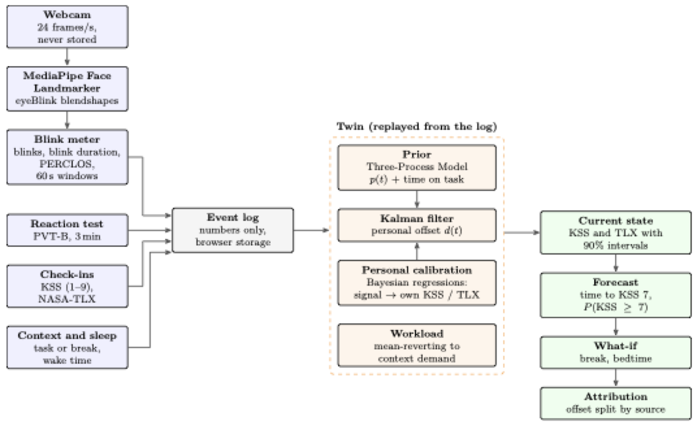
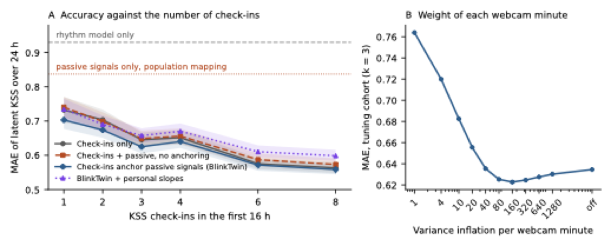

# BlinkTwin

**A real-time, laptop-scale digital twin of fatigue and cognitive load.** BlinkTwin watches your blinks, eyes and head through the webcam, tests your reaction time in three minutes, and uses short validated questionnaires as calibration points. A state-space model joins these with a published model of the body clock to estimate how sleepy and how loaded you are, forecast when you will become sleepy, and sound an alarm if you start to fall asleep. Everything runs in the browser, on your own laptop. Video never leaves the page.


## What makes BlinkTwin different

| | BlinkTwin | Fatigue models (SAFTE/FAST, 2B-Alert) | Camera drowsiness detectors | PVT apps | Questionnaires |
|---|:-:|:-:|:-:|:-:|:-:|
| Live sensing (eyes, head) | ✓ | | ✓ | | |
| Performance test | ✓ | | | ✓ | |
| Validated self-report | ✓ | | | | ✓ |
| Calibrates to the individual | ✓ | some | | | |
| Forecast and what-if | ✓ | ✓ | | | |
| Uncertainty on every estimate | ✓ | some | | | |
| Real-time microsleep alarm | ✓ | | ✓ | | |
| On-device, zero install, open source | ✓ | | some | some | ✓ |

1. **Questionnaire-anchored digital twin.** The Karolinska Sleepiness Scale and NASA-TLX are treated as calibration observations inside a Kalman filter, not just as labels. Check-ins set your level; blinks and reaction times track change from it.
2. **Anchored fusion that cannot be dragged off.** Each passive signal has its own bias term, so a webcam or reaction time that reads you wrong moves its anchor, not your estimate. In simulation, fusing signals without anchors gave no gain and overconfident uncertainty; with anchors BlinkTwin was never worse than check-ins alone and gave the best forecasts.
3. **Body-clock model plus live data in one filter.** The Three-Process Model of alertness supplies the daily rhythm; your data correct it. The result is a sleepiness estimate with a 90% range, a forecast of when you reach KSS 7 ("sleepy"), and what-if scenarios such as a break or an earlier bedtime.
4. **Real-time alarms with live eye and head tracking.** Eye closure longer than a second, or a head drop with closing eyes, triggers an alarm. Gaze, head pitch, yaw and roll, nods, blink rate, blink duration and PERCLOS update live.
5. **Explains itself.** Every estimate is split exactly into the rhythm model and what each signal contributed, and every prediction links to the science behind it ([docs/SCIENCE.md](docs/SCIENCE.md)).
6. **Private by design.** The face model runs in the page. Only one-minute numeric summaries are stored, in your own browser, and you can export or delete them.
7. **One codebase, tested and reproducible.** The same TypeScript runs the website, 44 unit tests and the simulation study, and the blink detector is validated against electro-oculography on a public dataset.

## How it works



| Signal | How it is measured | What it feeds |
|---|---|---|
| Eyes | MediaPipe Face Landmarker blendshapes in the browser; blinks with hysteresis on your own open-eye level; PERCLOS (time with eyes ≥ 80% closed); blink duration | Sleepiness (anchored), alarms |
| Head | Pitch, yaw and roll from the facial transformation matrix, relative to your resting pose; nods | Alarms |
| Reaction time | 3-minute PVT-B (1–4 s delays, lapses > 355 ms) | Sleepiness (anchored) |
| Check-ins | Karolinska Sleepiness Scale (1–9), NASA-TLX (0–100) | Calibration of the twin |
| Sleep | Wake time and hours slept | Three-Process Model prior |

The twin's state is your offset from the Three-Process Model plus one bias per passive signal. A Kalman filter updates it from every event, the forecast carries it forward with growing uncertainty, and workload relaxes towards the typical demand of your current activity. Full details, parameters and references: [docs/SCIENCE.md](docs/SCIENCE.md).

## Evidence so far

**The webcam blink detector works.** Run unchanged on the face landmarks of the public DROZY dataset (14 adults, 36 sessions under increasing sleep deprivation), BlinkTwin's blink code agreed with electro-oculography, the gold standard for blinks (Spearman ρ = 0.88 for blink rate).

**The signals track sleepiness within a person.** In DROZY, slower median reaction time (r = 0.77), more lapses (r = 0.73), more eye closure (PERCLOS, r = 0.53) and longer blinks (r = 0.51) went with higher sleepiness ratings within each person. Blink rate did not (r = 0.35, not significant). These relationships set BlinkTwin's population defaults.


**Objective and subjective sleepiness are only loosely linked across people.** In OpenNeuro ds004902 (71 adults, normal sleep vs a night without sleep), reaction time slowed in 90% of people but sleepiness ratings rose in only 73%, and the size of one change barely predicted the other (ρ = 0.25). This is why BlinkTwin anchors passive signals to each person's own ratings.

**Anchoring makes fusion safe (simulation, 300 virtual people, 24 h awake).** Mean absolute error of latent KSS:

| | 1 check-in | 3 check-ins | 8 check-ins |
|---|:-:|:-:|:-:|
| Rhythm model only | 0.930 | 0.930 | 0.930 |
| Check-ins only | 0.732 | 0.645 | 0.563 |
| Check-ins + passive signals, no anchoring | 0.740 | 0.649 | 0.573 |
| **BlinkTwin (anchored)** | **0.703** | **0.625** | **0.558** |
| BlinkTwin + personal slopes | 0.735 | 0.657 | 0.599 |

Forecasting KSS ≥ 7 one hour ahead (four check-ins): Brier score 0.062 for BlinkTwin, 0.067 for check-ins only, 0.098 for the rhythm model alone.



**What the evidence does not show yet.** In DROZY, calibrating from one or two check-ins did not beat the population formula. Gains from passive signals over check-ins are small in simulation. The alarm thresholds have not been validated. A study with real users is planned to test personal calibration, forecasting and alarm accuracy.

## Run it

**Desktop app (macOS):** double-click `BlinkTwin.app`. It starts the local server and opens BlinkTwin in its own window. Build it from [`app/BlinkTwin.applescript`](app/BlinkTwin.applescript) with `osacompile`, and use **Quit** in the app to stop the server.

**From the terminal:**

```bash
cd web
npm install
npm run dev
```

Open http://localhost:5173. Try **Demo day** to see a simulated person's day. Use Chrome or Edge for the webcam features.

## Reproduce the analyses

```bash
bash scripts/fetch_data.sh                                   # OpenNeuro ds004902 and DROZY (accepting their terms)
python3.13 -m venv analysis/.venv && analysis/.venv/bin/pip install -r analysis/requirements.txt
analysis/.venv/bin/python -I analysis/openneuro_pvt_kss.py data/raw/openneuro-ds004902/participants.tsv results
cd web && node scripts/drozy_eyes.ts ../data/raw/drozy/extracted/DROZY ../results/drozy_eyes.csv ../results/drozy_eye_minutes.csv && cd ..
analysis/.venv/bin/python -I analysis/drozy_eog.py data/raw/drozy/extracted/DROZY results/drozy_eog.csv
analysis/.venv/bin/python -I analysis/drozy_analysis.py data/raw/drozy/extracted/DROZY results
cd web && npm test && node scripts/simulate.ts 300 ../results && cd ..
analysis/.venv/bin/python -I analysis/sim_figures.py results
cd paper && latexmk -pdf main.tex
```

## Repository

| Path | Contents |
|---|---|
| `web/src/twin/` | The digital twin: Three-Process Model prior, Kalman filter with anchors, Bayesian calibration, forecast |
| `web/src/sensing/` | Blink meter, head pose and nods, real-time alerts, camera pipeline |
| `web/src/probes/`, `web/src/ui/` | PVT-B, check-in forms, charts, science explanations |
| `web/src/sim/`, `web/scripts/simulate.ts` | Virtual participants and the simulation study |
| `web/tests/` | Unit tests (vitest) |
| `analysis/` | Dataset analyses (Python) |
| `results/` | Summary statistics and figures (aggregates only) |
| `paper/` | Manuscript (LaTeX) |
| `docs/` | Science notes, project notes, images |
| `app/` | macOS launcher and icon |

## Status and limitations

Research prototype, not a medical device; it does not diagnose anything and must not be relied on for safety while driving or operating machinery. The Three-Process Model constants describe an average person. Population defaults come from 14 people in a sleep laboratory with a near-infrared camera and a 10-minute PVT, while BlinkTwin uses an ordinary webcam and a 3-minute PVT. Simulation results depend on how the virtual people were built.

## Data

- Xiang C, Fan X, Bai D, Lv K, Lei X. A resting-state EEG dataset for sleep deprivation. *Scientific Data* (2024). OpenNeuro ds004902.
- Massoz Q, Langohr T, François C, Verly JG. The ULg Multimodality Drowsiness Database (called DROZY) and examples of use. IEEE WACV 2016. Research use only; not redistributed here.

## Author

**Utsav Poudel** · utsav.poudel@outlook.com.au

BlinkTwin is a laptop-scale part of a research programme on real-time multimodal sensing and digital twins of cognitive load and fatigue.
