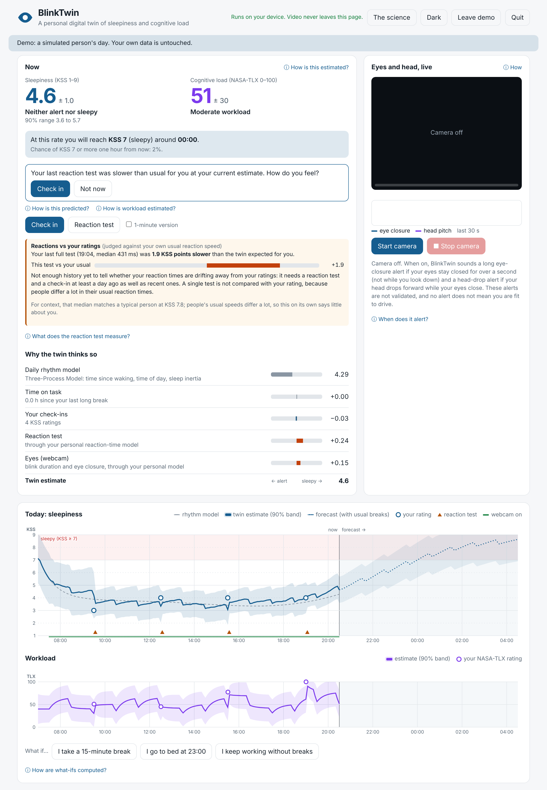
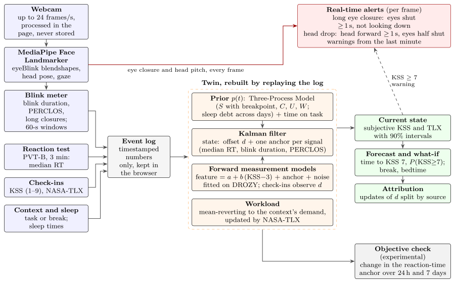
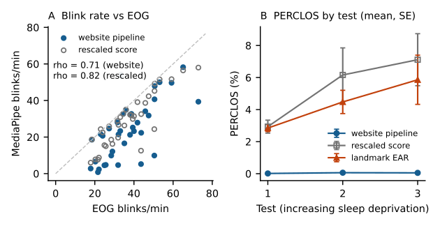
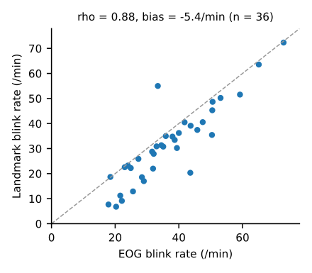
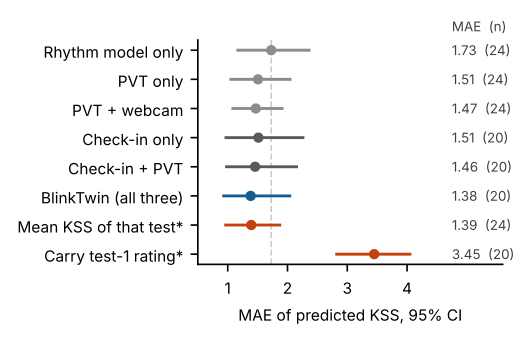
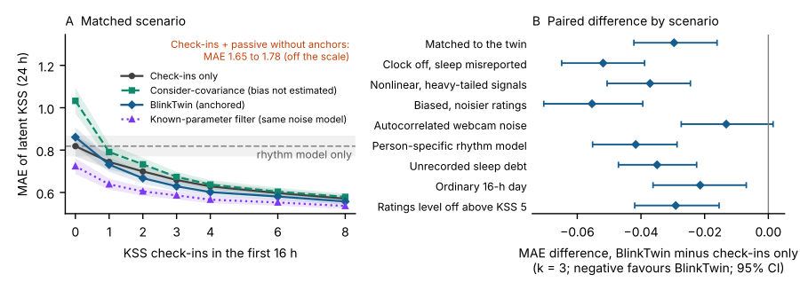

# BlinkTwin

*An open, in-browser model of subjective sleepiness that anchors webcam and reaction-time signals to self-ratings.* Preprint: [`paper/main.pdf`](paper/main.pdf) (arXiv version in preparation). Code: MIT licence.

**A laptop-scale personal model (a "digital twin") of sleepiness and perceived workload.** BlinkTwin watches your blinks, eyes and head through the webcam, tests your reaction time in three minutes, and uses short validated questionnaires as calibration points. A state-space model joins these with the published Three-Process Model of alertness to estimate how sleepy you feel and how loaded you are, forecast when you will reach "sleepy" (KSS 7), and raise an alert if your eyes stay shut or your head drops. Everything runs in the browser, on your own laptop. Video never leaves the page.

BlinkTwin is a research prototype. It has been tested on public datasets and in simulation, not yet in a prospective study with its own users, and it must not be used to decide whether someone is fit to drive or work.



## What BlinkTwin does, and how it compares

| | BlinkTwin | Fatigue models (Three-Process Model, SAFTE/FAST) | Individualised models (2B-Alert) | Camera drowsiness detectors | PVT apps | Questionnaires |
|---|:-:|:-:|:-:|:-:|:-:|:-:|
| Live passive sensing (eyes, head) | ✓ | | | ✓ | | |
| Performance test | ✓ | | ✓ | | ✓ | |
| Validated self-report as an input | ✓ | | | | | ✓ |
| Adjusts to the individual | level only | some | ✓ | some | | |
| Forecast and what-if | ✓ | ✓ | ✓ | | | |
| Uncertainty on the estimate | in simulation | some | ✓ | | | |
| Prospective validation in people | not yet | ✓ | ✓ | varies | ✓ | ✓ |
| Runs in a browser, open source | ✓ | | | some | some | free to use |

1. **Questionnaire-anchored state-space model.** The Karolinska Sleepiness Scale (KSS) and NASA-TLX enter a Kalman filter as calibration observations, not as training labels. Check-ins set your level; reaction times and the eyes track change from it.
2. **A forward measurement model for every passive signal.** Each signal is modelled as a population baseline, plus a change per KSS point fitted within people on DROZY, plus your own anchor, plus noise. The anchors are filter states, so a signal that reads you wrong moves its anchor, not your estimate. Without anchors, adding the same signals made the estimate much worse in simulation.
3. **The published Three-Process Model as the prior.** Homeostatic pressure with the 12.2 breakpoint in sleep recovery, the 24-h and 12-h rhythms, sleep inertia, and sleep debt carried across days (Åkerstedt et al. 2004, 2008; Ingre et al. 2014). The filter adds your offset, a 90% range, a forecast of when you reach KSS 7, and what-if scenarios such as a break or an earlier bedtime.
4. **Subjective estimate plus an objective check.** Because check-ins set the level, the main estimate is how sleepy you *feel*. People who are short of sleep often underrate their impairment, so the app also compares your reaction tests with your ratings. It flags a possible gap only when your own reaction times slow over a day or a week while your ratings do not; one test is not compared with a rating, because people's usual reaction times differ too much. This check is experimental.
5. **Real-time alerts with live eye and head tracking.** A long eye closure (1 s or more, not while looking down) or a forward head drop with closing eyes raises an alert. These thresholds are ad hoc defaults and have not been validated. Gaze, head pitch, yaw and roll, nods, blink rate, blink duration and PERCLOS update live.
6. **Explains itself.** The estimate is split into the rhythm model, time on task, and what each source contributed, and every number links to the science behind it ([docs/SCIENCE.md](docs/SCIENCE.md)).
7. **Private by design, and checked.** The face model runs in the page. Only one-minute numeric summaries are stored, in your own browser, and you can export or delete them. An automated traffic check (`web/scripts/privacy_check.mjs`) found that the face-tracking library sent small usage-statistics requests (timing data, no images) to a Google logging service every minute; a content security policy now blocks them, and the check records no request at all after the page has loaded (`results/privacy_check.json`).
8. **Learns how well it knows you.** A "How well does the twin know you?" panel scores every past prediction against the rating you then gave; the app suggests a check-in when the estimate is uncertain, the forecast nears KSS 7 or your reaction test disagrees with your ratings; it flags when your reactions are slower than your ratings suggest; and it asks for nights you did not enter instead of assuming you stayed awake.
9. **One codebase, tested and reproducible.** The same TypeScript runs the website, 126 unit tests, the replay of the released twin on real data, and the simulation study.

## How it works



| Signal | How it is measured | What it feeds |
|---|---|---|
| Eyes | MediaPipe Face Landmarker eyeBlink blendshapes in the browser; blinks with hysteresis on your own open-eye level; PERCLOS (time with eyes ≥ 80% closed on that scale); blink duration; long closures | Sleepiness (forward model with anchor), alerts |
| Head | Pitch, yaw and roll from the facial transformation matrix, relative to your resting pose; nods | Alerts |
| Reaction time | 3-minute PVT-B (1–4 s delays, lapses > 355 ms) | Sleepiness (forward model with anchor), objective check |
| Check-ins | Karolinska Sleepiness Scale (1–9), NASA-TLX (0–100) | Calibration of the twin |
| Sleep | Wake time and hours slept, night by night | Three-Process Model prior, including sleep debt |

The twin's sleepiness state is your offset from the Three-Process Model plus one anchor per passive signal (median reaction time, blink duration, PERCLOS), each in that signal's own units. A Kalman filter updates the state from every event, the forecast carries it forward with growing uncertainty, and workload relaxes towards the typical demand of your current activity. The twin ignores PERCLOS when the camera's blinks do not reach full closure, because then PERCLOS cannot register closed eyes. Full details, parameters and references: [docs/SCIENCE.md](docs/SCIENCE.md).

## Evidence so far

All numbers below are in `results/`. The DROZY analyses use 14 adults and 36 tests, so their confidence intervals are wide.

**The webcam pipeline, run on DROZY's videos.** We ran the website's exact pipeline (the same MediaPipe model file and blink code) on all 36 DROZY tests. A face was found in 99.9% of frames. Blink rate agreed moderately with electro-oculography (EOG), the reference for blinks (Spearman ρ = 0.71; within a person r = 0.65), with about 13 blinks per minute missed. Within a person, longer blinks (r = 0.58) and more long eye closures (r = 0.51) went with higher sleepiness ratings. PERCLOS failed on this near-infrared video: MediaPipe's closure score rarely came near full closure, so PERCLOS stayed below 0.5% in every test. This is why the twin now ignores PERCLOS in that situation. DROZY is not an ordinary webcam; webcam validation is still needed.



**The blink logic agrees with EOG on landmark data.** On DROZY's 68-point face landmarks (eye aspect ratio), the same blink code agreed with EOG blink rates (Spearman ρ = 0.88, n = 36 tests).



**The signals track sleepiness within a person.** In DROZY (landmark features), slower median reaction time (r = 0.77), more lapses (r = 0.73), more eye closure (PERCLOS, r = 0.53) and longer blinks (r = 0.51) went with higher sleepiness ratings within each person. Blink rate did not (r = 0.35, not significant). Within a person, median reaction time rose 18.8 ms per KSS point; people's baselines differed by about 49 ms. These forward models are BlinkTwin's population defaults.


**The released twin on real data (DROZY, each person left out in turn).** Error (mean absolute error, KSS points) when predicting the rating of the later, sleep-deprived tests:

| What the twin was given | MAE [95% CI] | Predictions |
|---|:-:|:-:|
| Rhythm model only | 1.73 [1.17, 2.36] | 24 |
| Reaction test and eyes, no check-in | 1.47 [1.09, 1.91] | 24 |
| Check-in at the first test only | 1.51 [0.97, 2.26] | 20 |
| **BlinkTwin: check-in at the first test + reaction test + eyes** | **1.38 [0.93, 2.04]** | 20 |
| Benchmark: the test's average rating in the other people | 1.39 [0.97, 1.87] | 24 |



The ordering matches the design, but the intervals overlap widely and BlinkTwin did not beat the simple benchmark. DROZY does not record wake times; assuming 06:00 or 08:00 instead of 07:00 gave BlinkTwin MAEs of 1.39 and 1.37.

**A personal offset carries over only partly.** In OpenNeuro ds004902 (33 adults with ratings after normal sleep and after a night without sleep), a person's offset from the rhythm model after normal sleep was only weakly related to their offset after sleep deprivation (r = 0.29, 95% CI −0.05 to 0.58). Adding a person's own normal-sleep offset predicted their rating after sleep deprivation no better than adding the group's average offset (MAE 1.52 with the shrunk personal offset, 1.45 with the group offset, 1.53 with the rhythm model alone). This is why the twin lets the offset drift and why the benefit of personal calibration is still an open question.

**The prior can be improved on real data.** On the same dataset (28 people with a sleep diary), two changes to the rhythm model were tested, both fixed in advance. Entering the diary's actual sleep did not help (MAE 1.74 vs 1.69). The KSS mapping refitted to airline crews by Ingre et al. (2014), KSS = 9.68 − 0.46 × alertness, lowered the error from 1.69 to 1.46 (difference −0.22, 95% CI −0.33 to −0.09) and predicted the size of the sleep-deprivation effect better (2.23 vs 2.90 points against an observed 2.04). The default has not been changed yet, because that needs the DROZY replay to be re-run (`results/openneuro_prior_summary.json`).

**Compared with published work.** No published KSS-prediction benchmark on DROZY or ds004902 was found; published DROZY results are drowsy-vs-awake classifications, which cannot be compared with an error in KSS points. The closest systems predict reaction-time performance rather than self-rated sleepiness. See [docs/LITERATURE_COMPARISON.md](docs/LITERATURE_COMPARISON.md) for every comparable study, its dataset and metric (peer-reviewed papers with a DOI only).

**Simulation (300 virtual people per scenario, 24 h awake, released defaults, nothing tuned on simulated people).** Mean absolute error of latent KSS, matched scenario:

| | k = 0 | k = 1 | k = 3 | k = 8 | 90% coverage, k = 3 | 90% width, k = 3 |
|---|:-:|:-:|:-:|:-:|:-:|:-:|
| Rhythm model only | 0.819 |  |  |  | 0.98 (k = 0) | 5.21 |
| Check-ins only |  | 0.744 | 0.659 | 0.571 | 0.91 | 2.84 |
| Check-ins + passive signals, no anchors |  | 1.782 | 1.741 | 1.655 | 0.24 | 1.33 |
| **BlinkTwin (anchored)** | **0.861** | **0.731** | **0.629** | **0.557** | 0.90 | 2.64 |
| Check-ins + passive, consider-covariance (bias allowed for, not estimated) | 1.032 | 0.791 | 0.673 | 0.579 | 0.90 | 2.78 |
| Known-parameter filter (true signal parameters, same noise model; a reference, not a bound) | 0.724 | 0.639 | 0.586 | 0.536 | 0.87 | 2.30 |

k is the number of KSS check-ins in the first 16 h. With no check-ins (k = 0), BlinkTwin and the known-parameter filter use the reaction test and eyes only, and BlinkTwin was then slightly worse than the rhythm model alone (0.861 vs 0.819), because the population baselines it must start from are off for most people. With three check-ins, BlinkTwin was better than check-ins alone for 64% of virtual people (difference −0.030, 95% CI −0.042 to −0.016); per-person differences ranged from −0.207 to 0.161 (5th to 95th percentile), so the gain is small and not universal.

The same comparison with three check-ins when the virtual people break the twin's assumptions on purpose (difference BlinkTwin minus check-ins only, 95% CI):

| Scenario | Check-ins only | BlinkTwin | Difference [95% CI] | BlinkTwin better for |
|---|:-:|:-:|:-:|:-:|
| Matches the twin's assumptions | 0.659 | 0.629 | −0.030 [−0.042, −0.016] | 64% |
| Body clock off (SD 2 h) and sleep misreported (SD 1.5 h) | 0.763 | 0.711 | −0.052 [−0.065, −0.039] | 66% |
| Signals respond nonlinearly, heavy-tailed noise | 0.671 | 0.633 | −0.037 [−0.051, −0.024] | 63% |
| People rate with a personal bias (SD 0.8) and more noise | 0.918 | 0.863 | −0.055 [−0.071, −0.039] | 68% |
| Webcam noise far more autocorrelated than assumed | 0.659 | 0.646 | −0.013 [−0.027, 0.001] | 53% |
| Person-specific Three-Process Model (homeostatic rate, circadian amplitude) | 0.697 | 0.656 | −0.042 [−0.055, −0.029] | 66% |
| Unrecorded sleep debt (five 5-h nights; the twin knows only the last) | 0.633 | 0.598 | −0.035 [−0.047, −0.023] | 65% |
| Ordinary 16-h day instead of 24 h awake | 0.682 | 0.661 | −0.021 [−0.036, −0.007] | 56% |
| Ratings level off above KSS 5 while signals keep rising | 0.665 | 0.636 | −0.029 [−0.042, −0.015] | 62% |

Forecasting KSS ≥ 7 one hour ahead (matched scenario, three check-ins, 5400 forecasts, base rate 0.27): Brier score 0.063 for BlinkTwin, 0.066 for check-ins only and 0.086 for the rhythm model alone (difference from check-ins only −0.0028, 95% CI −0.0052 to −0.0001); AUROC 0.969, 0.966 and 0.945. Most of the discrimination comes from the time of day and time awake.



**What the evidence does not show yet.** That personal calibration helps real people: in DROZY the twin did not beat a simple benchmark, and in ds004902 offsets carried over only weakly. Gains from the passive signals over check-ins are small in simulation (hundredths of a KSS point), and they come from estimating each signal's personal bias: a filter that only allows for the bias without estimating it (consider-covariance) was no better than check-ins alone. In a simulated version of the planned 10-day study, where the target is people's actual (noisy, whole-number) ratings on ordinary workdays and the whole log is replayed as one, BlinkTwin was slightly better than check-ins alone (mean difference −0.010 KSS points, SD 0.036), and more so with a mean-reverting offset (−0.028 to −0.047); replaying each day on its own reversed the sign (+0.019), so the benefit depends on carrying the anchors across days. The webcam pipeline has not been validated on ordinary webcams, the alert thresholds have not been validated at all, and the workload estimate has not been evaluated. A prospective study with real users is planned.

## Documentation

| Document | What it is for |
|---|---|
| [docs/HOW_IT_WORKS.md](docs/HOW_IT_WORKS.md) | Everything the app does, in plain language, with worked examples and a FAQ |
| [docs/SCIENCE.md](docs/SCIENCE.md) | The science text shown in the app, with references |
| [docs/LITERATURE_COMPARISON.md](docs/LITERATURE_COMPARISON.md) | Published systems, their datasets, metrics and accuracies, compared with BlinkTwin |
| [docs/PUBLICATION_PLAN.md](docs/PUBLICATION_PLAN.md) | Venue options and the planned order of papers |
| [paper/](paper/) | Preprint (IEEE two-column, appendices included), the arXiv package `paper/blinktwin-arxiv.tar.gz` and its build script; referee reports and responses in `paper/reviews/` |
| [HANDOFF.md](HANDOFF.md) | Current status, how to merge this revision, what to run next |

## Run it

**Desktop app (macOS):** double-click `BlinkTwin.app`. It starts the local server and opens BlinkTwin in its own window. Build it from [`app/BlinkTwin.applescript`](app/BlinkTwin.applescript) with `osacompile`, and use **Quit** in the app to stop the server.

**From the terminal** (Node.js 22.6 or later, which runs the TypeScript scripts directly):

```bash
cd web
npm install
npm run dev
```

Open http://localhost:5173. Try **Demo day** to see a simulated person's day. Use Chrome or Edge for the webcam features.

## Reproduce the analyses

Requirements: Node.js ≥ 22.6, Python 3.13. Raw data stay in `data/` (not in git); `results/` holds aggregates only.

```bash
bash scripts/fetch_data.sh                                   # OpenNeuro ds004902 and DROZY (accepting their terms)
python3.13 -m venv analysis/.venv && analysis/.venv/bin/pip install -r analysis/requirements.txt
(cd web && npm install && npm test)

# OpenNeuro ds004902
analysis/.venv/bin/python -I analysis/openneuro_pvt_kss.py data/raw/openneuro-ds004902/participants.tsv results
(cd web && node scripts/openneuro_anchor.ts ../data/raw/openneuro-ds004902/participants.tsv ../results)

# DROZY: landmark blink meter, EOG blinks, session analysis, forward models, replay of the released twin
(cd web && node scripts/drozy_eyes.ts ../data/raw/drozy/extracted/DROZY ../results/drozy_eyes.csv ../results/drozy_eye_minutes.csv)
analysis/.venv/bin/python -I analysis/drozy_eog.py data/raw/drozy/extracted/DROZY results/drozy_eog.csv
analysis/.venv/bin/python -I analysis/drozy_analysis.py data/raw/drozy/extracted/DROZY results
analysis/.venv/bin/python -I analysis/drozy_forward.py results
(cd web && node scripts/drozy_twin.ts ../data/raw/drozy/extracted/DROZY ../results)

# The website's MediaPipe pipeline on the DROZY videos
python3.13 -m venv data/venv-mediapipe && data/venv-mediapipe/bin/pip install mediapipe opencv-python-headless
(cd web && node scripts/fetch-model.mjs)
data/venv-mediapipe/bin/python -I analysis/drozy_mediapipe_compare.py extract data/raw/drozy/extracted/DROZY web/public/models/face_landmarker.task data/derived/drozy_mediapipe_frames
(cd web && node scripts/drozy_mediapipe_blinks.ts ../data/derived/drozy_mediapipe_frames ../results/drozy_mediapipe_tests.csv ../results/drozy_mediapipe_minutes.csv)
analysis/.venv/bin/python -I analysis/drozy_mediapipe_compare.py compare results

# Checks of the prior on OpenNeuro ds004902 (sleep diary, KSS mapping)
(cd web && node scripts/openneuro_prior_check.ts ../data/raw/openneuro-ds004902/participants.tsv ../results)
analysis/.venv/bin/python -I analysis/drozy_twin_figure.py results

# Simulation study, power for the planned study, and their figures (about half an hour)
(cd web && node scripts/simulate.ts 300 ../results > ../results/sim_log.txt)
(cd web && node scripts/power.ts)
analysis/.venv/bin/python -I analysis/sim_figures.py results

# Figures and screenshots in this README (SVG from the paper's PDFs; demo-day screenshots at 2x)
bash scripts/readme_figures.sh
(cd web && node scripts/screenshots.mjs)

# Privacy traffic check and compute benchmark (headless Chromium with a fake camera)
(cd web && node scripts/privacy_check.mjs && node scripts/benchmark.mjs)

# Paper (appendices included) and the arXiv package, tested to compile on its own
(cd paper && latexmk -pdf main.tex && bash make_arxiv.sh)
```

## Repository

| Path | Contents |
|---|---|
| `web/src/twin/` | The twin: Three-Process Model prior, Kalman filter with forward measurement models and anchors, forecast |
| `web/src/sensing/` | Blink meter, head pose and nods, real-time alerts, camera pipeline |
| `web/src/insights/` | Track record of past predictions, check-in suggestions, reactions vs ratings, sleep-history status |
| `web/src/probes/`, `web/src/ui/` | PVT-B, check-in forms, charts, science explanations |
| `web/src/sim/`, `web/scripts/simulate.ts` | Virtual participants and the simulation study |
| `web/scripts/` | DROZY and OpenNeuro replays of the released twin, MediaPipe validation, data tools |
| `web/tests/` | Unit tests (vitest) |
| `analysis/` | Dataset analyses and figures (Python) |
| `results/` | Summary statistics and figures (aggregates only) |
| `paper/` | Manuscript (LaTeX) and review rounds |
| `docs/` | Science notes, project notes, images |
| `app/` | macOS launcher and icon |

## Status and limitations

Research prototype, not a medical device; it does not diagnose anything and must not be relied on for safety while driving or operating machinery. The absence of an alert does not mean a person is alert. The main estimate is subjective sleepiness, anchored to the person's own ratings. The Three-Process Model constants describe an average person, and the model does not adapt to shift work, travel across time zones, naps or caffeine. The signal models come from 14 people in a sleep laboratory with a near-infrared camera and a 10-minute PVT, while BlinkTwin uses an ordinary webcam and a 3-minute browser PVT. Simulation results depend on how the virtual people were built.

## Data

- Xiang C, Fan X, Bai D, Lv K, Lei X. A resting-state EEG dataset for sleep deprivation. *Scientific Data* 11:427 (2024). OpenNeuro ds004902.
- Massoz Q, Langohr T, François C, Verly JG. The ULg Multimodality Drowsiness Database (called DROZY) and examples of use. IEEE WACV 2016. Research use only; not redistributed here.

## Licence and citation

The code is released under the [MIT licence](LICENSE). If you use BlinkTwin, please cite the preprint and the software (see [`CITATION.cff`](CITATION.cff)):

> Poudel U. BlinkTwin: An Open, In-Browser Model of Subjective Sleepiness That Anchors Webcam and Reaction-Time Signals to Self-Ratings. Preprint, 2026. Code: https://github.com/r11up/BlinkTwin (tag v1.0-arxiv).

The DROZY and OpenNeuro data keep their own licences (see Data above); none of their raw files are in this repository.

## Author

**Utsav Poudel** · utsav.poudel@outlook.com.au

BlinkTwin is a laptop-scale part of a research programme on real-time multimodal sensing and personal models of cognitive load and fatigue.
